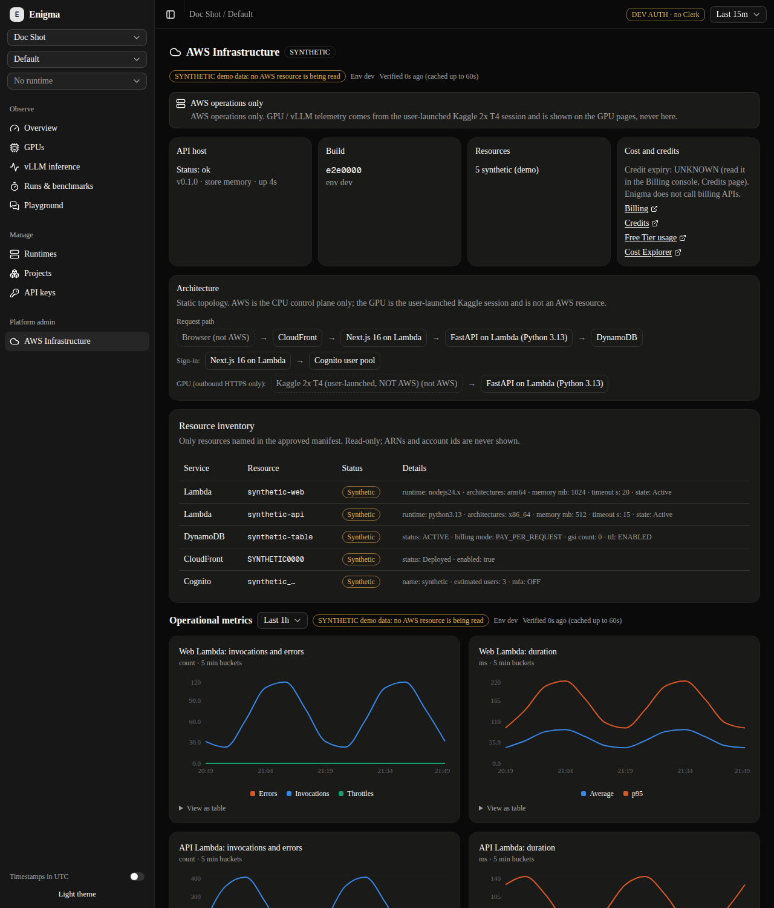

# AWS operations visibility — two dashboards, neither deployed

**Status:** CloudWatch dashboard = **DRAFT, NOT DEPLOYED**. Enigma admin page = **built and tested in MOCK (synthetic) mode; LIVE mode implemented but never run against AWS**. No AWS resource exists. No `PutDashboard`, IAM, DynamoDB, Lambda, Cognito, S3, CloudFront or Budgets call has been made.

**Boundary.** Both dashboards show **AWS control-plane operations only** (web and API Lambdas, DynamoDB, CloudFront, optionally Cognito). They never show GPU or vLLM data. That comes from the user-launched Kaggle 2× T4 session (`nvidia-ml-py`, native vLLM `/metrics`) and lives on Enigma's GPU/inference pages, with its own labels, permissions and clocks. There is no AWS GPU.



*Screenshot of the real page rendered from the deterministic mock (`ENIGMA_AWS_OPS=mock`). Every number on it is synthetic and the page says so; no AWS resource was read.*

---

## A. Native CloudWatch dashboard `Enigma-Control-Plane` (draft)
**File:** `infra/aws/dashboards/enigma-control-plane.json` · **30 metric series** (limit 50) · 11 widgets (1 text, 10 metric).

| Group | Metrics (all AWS-provided, no custom metrics) |
|---|---|
| Web Lambda | `AWS/Lambda` Invocations, Errors, Throttles (Sum); Duration (Average, p95); ConcurrentExecutions (Maximum) |
| API Lambda | same six |
| DynamoDB | `ConsumedRead/WriteCapacityUnits`, `Read/WriteThrottleEvents`, `ConditionalCheckFailedRequests`, `TimeToLiveDeletedItemCount` (per table); `SystemErrors` × 5 operations; `SuccessfulRequestLatency` × 2 operations |
| CloudFront | `AWS/CloudFront` Requests, BytesDownloaded, 4xx/5xx/Total error rate (queried in `us-east-1`; CloudFront metrics exist only there) |

**Deliberately excluded:** Cognito metrics (free-of-charge status not verified), CloudFront *additional* metrics (paid), Container Insights, Application Signals, X-Ray, RUM, Synthetics canaries, scheduled Logs Insights, metric streams, custom metrics, alarms, and any agent install.

**Placeholders** (never real values in Git): `${AWS_REGION}`, `${WEB_FUNCTION_NAME}`, `${API_FUNCTION_NAME}`, `${DDB_TABLE_NAME}`, `${CLOUDFRONT_DISTRIBUTION_ID}`. The first widget states **"DRAFT. NOT DEPLOYED."** and that it contains no GPU data.

**Offline validation** (`tests/test_cloudwatch_dashboard.py`, 15 tests, each rule has a failing-input test): approved namespaces only; every metric/dimension/unit matches a pinned catalog; valid statistics; periods ∈ {60, 300, 900, 3600}; titles state their unit; ≤ 50 series; 24-column grid with no overlap; no log/alarm/query widgets; only known placeholders; CloudFront in `us-east-1`; and `tests/api/test_awsops.py` asserts the in-app reader queries a **subset of exactly these metrics**.
*Limit of this proof:* it checks structure against my catalog of documented metric names. Whether each metric **exists** in the account is only knowable after deployment (CloudWatch lists a metric after its first datapoint); `check_dashboard_quota.py --verify-metrics` lists the ones not yet emitted.

### Free allowance and the pre-flight (read-only)
CloudWatch's published always-free allowance includes **3 custom dashboards** (each up to 50 metrics). **Whether it applies to this PAID-plan account is UNVERIFIED**, and dashboards, GetMetricData calls, logs and metrics are billable beyond limits. Before any `PutDashboard`:

```bash
# offline: validates the draft, prints the procedure, calls NOTHING
/usr/local/bin/python3.13 scripts/check_dashboard_quota.py
# read-only, NON-ROOT only: counts existing dashboards, reports whether a free slot exists
/usr/local/bin/python3.13 scripts/check_dashboard_quota.py --read-only --profile <non-root> --region <approved>
# after resources exist: which metrics have not been emitted yet
/usr/local/bin/python3.13 scripts/check_dashboard_quota.py --read-only --profile <non-root> --region <approved> --verify-metrics --set AWS_REGION=... --set WEB_FUNCTION_NAME=...
```
The script **refuses to run as root**, has **no write call anywhere** (a test parses its AST), and reports `OK_TO_REQUEST_APPROVAL` or `STOP_NO_FREE_SLOT_OR_TOO_MANY_METRICS`. Even `OK` is not an authorisation. If a free slot is not confirmed, **stop and use the AWS console's built-in service views instead.**

### Deployment plan (not executed; needs your approval)
1. Non-root identity and approved region (docs/AWS_ROOT_KEY_REMEDIATION.md). 2. The resources exist and have served traffic (otherwise most graphs are empty). 3. Run the read-only pre-flight above. 4. You approve the single write `cloudwatch:PutDashboard` for `Enigma-Control-Plane`. 5. Substitute the placeholders from the approved manifest and `aws cloudwatch put-dashboard`. 6. Record the dashboard URL privately; change its status here to LIVE **only** with the real URL and visible data. **Rollback:** `aws cloudwatch delete-dashboards --dashboard-names Enigma-Control-Plane`. **Log retention:** both Lambda log groups at 7 days (`infra/aws/template.yaml`); never log prompts or tokens.

---

## B. Enigma-admin-only "AWS Infrastructure" page
**Route:** `/app/admin/aws` (nav item **AWS Infrastructure**, shown only to the platform admin). **Backend:** `GET /api/v1/app/admin/aws/{status,metrics,cost}`; the browser reaches them only through the BFF allow-list.

### Authorization (default deny, enforced on the backend)
| Caller | Result |
|---|---|
| anonymous / invalid or forged token | **401** |
| authenticated, not in `ENIGMA_ADMIN_SUBJECTS` | **403** (evaluated *before* validation, so a non-admin cannot probe parameters) |
| in `ENIGMA_ADMIN_SUBJECTS` | 200 |
| `ENIGMA_ADMIN_SUBJECTS` empty | nobody is admin |
Matching is exact (no case-folding, no prefix match, no namespace confusion: `cognito:<sub>` ≠ `<sub>`). Hiding the nav item is cosmetic; the API is the gate. Tested at pytest level (direct API) and in the browser (two simultaneous users, direct BFF calls, nav absent, page shows "Not authorised").

### What it shows, and the honesty states
| State | Meaning |
|---|---|
| **NOT DEPLOYED** | "No Enigma AWS resources deployed." No graphs are fabricated. This is the default (`ENIGMA_AWS_OPS=off`). |
| **SYNTHETIC** | Demo data from the deterministic mock; every badge says so; refused in production configuration. |
| **DEPLOYED / PARTIAL** | Per resource, read from AWS. |
| **UNKNOWN** | A read failed for a reason other than "not found"; AWS error text is never shown. |
| **NOT AUTHORIZED** | The reader role was denied; reported as such, never as zero. |
| **NO DATA** | CloudWatch returned no datapoints (some metrics appear only after the first request); shown as empty, not as 0. |
| **STALE** | The last refresh failed; older cached data is shown with its age. |
Content: resource inventory (service, name, status, runtime/architecture/memory/timeout, table billing mode/GSI count/TTL, distribution status, user count), region, environment, build SHA, API health/version/store/uptime, a static topology panel that places **Kaggle outside AWS**, Lambda/DynamoDB/CloudFront charts (existing shadcn + Recharts; each chart has a "View as table"), and a **cost panel that only links out** to the AWS console (Billing, Credits, Free Tier, Cost Explorer) and states credit expiry as **UNKNOWN**. Enigma never calls Cost Explorer or Billing APIs (they can be billed).

### How it reads AWS (live mode)
* **Credentials:** the API's execution role only. Never settings, never the browser, never root. No browser-side AWS SDK.
* **Resource ids** come **only** from a validated manifest (`ENIGMA_AWS_MANIFEST`; strict regexes, unknown keys rejected). Nothing from a request is ever an AWS identifier. No account listing, no Resource Explorer.
* **Calls (exactly six, all read-only):** `lambda:GetFunctionConfiguration`, `dynamodb:DescribeTable`, `dynamodb:DescribeTimeToLive`, `cloudfront:GetDistribution`, `cognito-idp:DescribeUserPool`, `cloudwatch:GetMetricData`. The matching least-privilege policy is `infra/aws/iam/enigma-api-ops-reader-policy.json`, and a test asserts policy ⇔ code equality.
* **Bounded:** fixed windows 1 h/6 h/24 h with 5/15/60-minute periods (≤ 288 points), ≤ 3 `NextToken` pages, 2 s connect / 5 s read timeout, 2 retries, **TTL cache ≥ 30 s (default 60 s)** with single-flight (8 concurrent page loads → 1 AWS refresh), stale-on-error, and a per-user rate limit. The page refreshes every 60 s and pauses while the tab is hidden; there is no 1-second polling.
* **Output hygiene:** every payload is scrubbed of ARNs, 12-digit account ids and access-key-shaped strings; AWS error codes are mapped to a state and never echoed.

### Tests
`tests/api/test_awsops.py` (26: authorization, states, manifest strictness, only-whitelisted-calls, no cost/billing/IAM client ever created, ids only from manifest, bounded windows/pagination, TTL cache and single flight, stale-on-error, datapoint round-trip through CloudWatch, scrubbing; the live reader runs against moto with fake credentials). `e2e/aws-admin.spec.ts` (6 browser tests incl. axe dark/light, no hot polling, two users). `tests/test_iac_governance.py` (policies/manifest).

### Configuration (names only)
`ENIGMA_ADMIN_SUBJECTS`, `ENIGMA_AWS_OPS` (`off|mock|live`), `ENIGMA_AWS_MANIFEST`, `ENIGMA_AWS_OPS_CACHE_S`, `ENIGMA_BUILD_SHA`, `ENIGMA_ENVIRONMENT`. Live mode refuses to start without a valid manifest and at least one admin; mock is refused in production.

---

## What is NOT done (precisely)
CloudWatch dashboard not created · live page never run against AWS · no real resource, metric or URL exists · free-dashboard allowance unverified · whether each drafted metric exists unverified · Cognito panel omitted · cost/credit data is link-out only because no safe, free, permitted data source exists. This document changes status only with real URLs and visible data.
